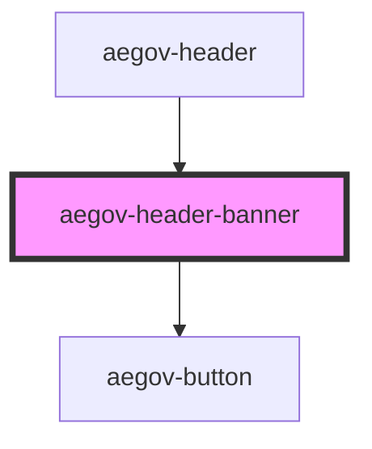

# aegov-header-banner

<!-- Auto Generated Below -->

## Properties

| Property               | Attribute                | Description                                                                                                                                                                           | Type     | Default     |
| ---------------------- | ------------------------ | ------------------------------------------------------------------------------------------------------------------------------------------------------------------------------------- | -------- | ----------- |
| `entityDomain`         | `entity-domain`          | The domain/URL of the government entity. Required.                                                                                                                                    | `string` | `undefined` |
| `entityName`           | `entity-name`            | The name of the government entity. Required.                                                                                                                                          | `string` | `undefined` |
| `skipContentContainer` | `skip-content-container` | The CSS selector or ID of the main content container to skip to (e.g. "#main-content"). When provided, renders a "Skip to content" link before the header for keyboard accessibility. | `string` | `undefined` |

## Dependencies

### Used by

 - [aegov-header](../aegov-header)

### Depends on

- [aegov-button](../aegov-button)

### Graph

----------------------------------------------

*Built with [StencilJS](https://stenciljs.com/)*
