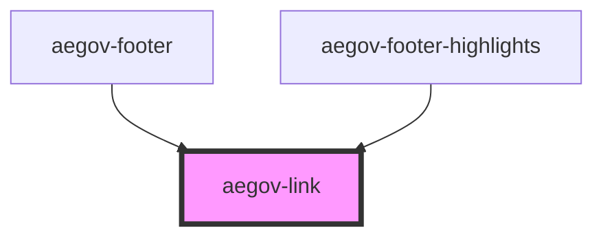

# aegov-link

<!-- Auto Generated Below -->

## Properties

| Property            | Attribute     | Description                                                                                                                                                                                                       | Type                                                                     | Default     |
| ------------------- | ------------- | ----------------------------------------------------------------------------------------------------------------------------------------------------------------------------------------------------------------- | ------------------------------------------------------------------------ | ----------- |
| `appearance`        | `appearance`  | Button-style appearance. Setting this opts into button styling.                                                                                                                                                   | `"link" \| "outline" \| "soft" \| "solid"`                               | `undefined` |
| `extraClass`        | `extra-class` | Additional CSS classes to apply to the link.                                                                                                                                                                      | `string`                                                                 | `undefined` |
| `fieldId`           | `field-id`    | Unique ID for the inner anchor element. Auto-generated if not provided.                                                                                                                                           | `string`                                                                 | `undefined` |
| `href` _(required)_ | `href`        | The URL that the link points to.                                                                                                                                                                                  | `string`                                                                 | `undefined` |
| `isBold`            | `is-bold`     | Bold text.                                                                                                                                                                                                        | `boolean`                                                                | `true`      |
| `isDisabled`        | `is-disabled` | Disable navigation and apply disabled styling. Adds `aria-disabled="true"`, removes the link from tab order, and prevents default click navigation. Native `<a>` does not support `disabled`; this is a polyfill. | `boolean`                                                                | `false`     |
| `isFull`            | `is-full`     | Stretch to fill container width.                                                                                                                                                                                  | `boolean`                                                                | `false`     |
| `isIcon`            | `is-icon`     | Render as icon-only (square). Requires a button-style appearance.                                                                                                                                                 | `boolean`                                                                | `false`     |
| `rel`               | `rel`         | Rel attribute for the link (e.g., "noopener noreferrer" for external links).                                                                                                                                      | `string`                                                                 | `undefined` |
| `size`              | `size`        | Button-style size (xs/sm/base/lg/xl, optionally responsive).                                                                                                                                                      | `string`                                                                 | `undefined` |
| `target`            | `target`      | Target attribute for the link (_blank, _self, _parent, _top).                                                                                                                                                     | `"_blank" \| "_parent" \| "_self" \| "_top"`                             | `undefined` |
| `variant`           | `variant`     | Button-style color variant. Setting this opts into button styling.                                                                                                                                                | `"danger" \| "neutral-max" \| "neutral-min" \| "primary" \| "secondary"` | `undefined` |

## Events

| Event            | Description                                                                                                          | Type                                                |
| ---------------- | -------------------------------------------------------------------------------------------------------------------- | --------------------------------------------------- |
| `aegovLinkClick` | Emitted when the link is clicked. The event detail contains the href and can be used to implement custom navigation. | `CustomEvent<{ href: string; event: MouseEvent; }>` |

## Slots

| Slot        | Description                                                                                                                                                                                                                                                                                                                                                                                                                                                                                                                                                                                                                                                                                                                                                                           |
| ----------- | ------------------------------------------------------------------------------------------------------------------------------------------------------------------------------------------------------------------------------------------------------------------------------------------------------------------------------------------------------------------------------------------------------------------------------------------------------------------------------------------------------------------------------------------------------------------------------------------------------------------------------------------------------------------------------------------------------------------------------------------------------------------------------------- |
| `"default"` | The link text content  An anchor element wrapper.  In its default form `aegov-link` renders a plain styled `<a>`. Opt into a button-shaped link by setting any of `variant`, `appearance`, `size`, `isIcon`, `isFull`, or `isDisabled`. When any of those are set the component switches its class output to the shared `getActionClasses` util so it matches `aegov-button` exactly while keeping native `<a>` semantics (right-click, middle-click new tab, screen-reader link role, copy-link, etc.). `isBold` only has an effect once one of the props above has already opted in — it can't itself trigger button styling since it defaults to `true`.  `isLoading` is intentionally NOT supported — loading states belong on `<button>` (use `aegov-button isLoading` instead). |

## Dependencies

### Used by

 - [aegov-footer](../aegov-footer)
 - [aegov-footer-highlights](../aegov-footer-highlights)

### Graph

----------------------------------------------

*Built with [StencilJS](https://stenciljs.com/)*
