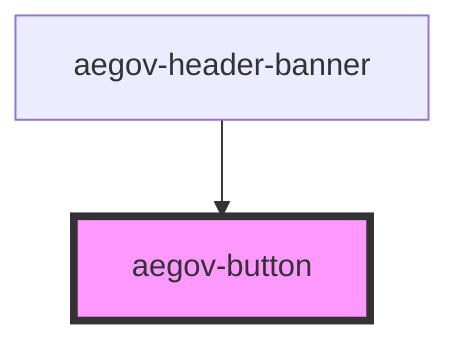

# aegov-button

A versatile button component with multiple variants, sizes, and interactive states for all user actions.

## Features

- **4 Variants**: Solid, Outline, Soft, and Link styles
- **2 Appearances**: Primary and Secondary color schemes
- **4 Sizes**: XS, SM, Base, and LG
- **Loading State**: Built-in spinner for async operations
- **Disabled State**: Clear visual feedback for non-interactive state
- **Full Width**: Option to span full container width
- **Accessible**: Semantic HTML with proper ARIA attributes

## Overview

Buttons are the primary interactive elements in user interfaces. This component provides a comprehensive set of visual styles and states to handle all button use cases, from primary calls-to-action to subtle text links.

<!-- Auto Generated Below -->

## Properties

| Property     | Attribute     | Description                                                       | Type                                                                   | Default     |
| ------------ | ------------- | ----------------------------------------------------------------- | ---------------------------------------------------------------------- | ----------- |
| `appearance` | `appearance`  | The button appearance (visual style)                              | `"link" \| "outline" \| "soft" \| "solid"`                             | `'solid'`   |
| `fieldId`    | `field-id`    | Unique ID for the button element. Auto-generated if not provided. | `string`                                                               | `undefined` |
| `isBold`     | `is-bold`     | Whether the button should have bold text or not                   | `boolean`                                                              | `true`      |
| `isDisabled` | `is-disabled` | Whether the button is disabled                                    | `boolean`                                                              | `false`     |
| `isFull`     | `is-full`     | Whether the button should take full width                         | `boolean`                                                              | `false`     |
| `isIcon`     | `is-icon`     | Whether the button is only an icon                                | `boolean`                                                              | `false`     |
| `isLoading`  | `is-loading`  | Whether the button is in a loading state                          | `boolean`                                                              | `false`     |
| `size`       | `size`        | The button size                                                   | `string`                                                               | `'base'`    |
| `type`       | `type`        | The button type attribute                                         | `"button" \| "reset" \| "submit"`                                      | `'button'`  |
| `variant`    | `variant`     | The button variant (color scheme)                                 | `"danger" \| "neutralMax" \| "neutralMin" \| "primary" \| "secondary"` | `'primary'` |

## Events

| Event              | Description                            | Type                      |
| ------------------ | -------------------------------------- | ------------------------- |
| `aegovButtonBlur`  | Emitted when the button loses focus    | `CustomEvent<FocusEvent>` |
| `aegovButtonClick` | Emitted when the button is clicked     | `CustomEvent<MouseEvent>` |
| `aegovButtonFocus` | Emitted when the button receives focus | `CustomEvent<FocusEvent>` |

## Slots

| Slot | Description    |
| ---- | -------------- |
|      | Button content |

## Shadow Parts

| Part       | Description               |
| ---------- | ------------------------- |
| `"button"` | The native button element |

## Dependencies

### Used by

 - [aegov-header-banner](../aegov-header-banner)

### Graph

----------------------------------------------

*Built with [StencilJS](https://stenciljs.com/)*
