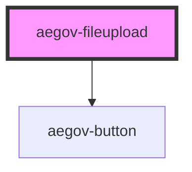

# aegov-fileupload

<!-- Auto Generated Below -->

## Properties

| Property       | Attribute       | Description                                                                                                                                             | Type                                                         | Default     |
| -------------- | --------------- | ------------------------------------------------------------------------------------------------------------------------------------------------------- | ------------------------------------------------------------ | ----------- |
| `accept`       | `accept`        | Accepted file types (e.g. ".pdf,.jpg,image/*").                                                                                                         | `string`                                                     | `undefined` |
| `appearance`   | `appearance`    | Variant style: 'default' (styled input + button), 'button' (hidden input, label-as-button), or 'dropzone' (drag-and-drop area).                         | `"button" \| "default" \| "dropzone"`                        | `'default'` |
| `errorMessage` | `error-message` | Inline error message. Use `error` slot for rich markup.                                                                                                 | `string`                                                     | `''`        |
| `fieldId`      | `field-id`      | Unique field ID. Auto-generated if not provided.                                                                                                        | `string`                                                     | `undefined` |
| `hint`         | `hint`          | Helper hint text displayed below the label. Renamed from `description` per §6.6 (pre-production rename, no compat shim). Hidden when an error is shown. | `string`                                                     | `undefined` |
| `isDisabled`   | `is-disabled`   | Disables the file upload.                                                                                                                               | `boolean`                                                    | `false`     |
| `isInvalid`    | `is-invalid`    | Visual + a11y invalid state. See §2.3.                                                                                                                  | `boolean`                                                    | `false`     |
| `isMultiple`   | `is-multiple`   | Allow multiple file selection.                                                                                                                          | `boolean`                                                    | `false`     |
| `isRequired`   | `is-required`   | Marks the field as required.                                                                                                                            | `boolean`                                                    | `false`     |
| `label`        | `label`         | Label text displayed above the control.                                                                                                                 | `string`                                                     | `undefined` |
| `labelButton`  | `label-button`  | Custom text for the browse/trigger button.                                                                                                              | `string`                                                     | `undefined` |
| `labelHelp`    | `label-help`    | Custom helper text for allowed file types. Overrides auto-generated text from `accept`. Shown alongside the hint, distinct from validation error text.  | `string`                                                     | `undefined` |
| `maxFileSize`  | `max-file-size` | Maximum file size in bytes.                                                                                                                             | `number`                                                     | `undefined` |
| `maxFiles`     | `max-files`     | Maximum number of files (multiple mode only). No limit by default.                                                                                      | `number`                                                     | `undefined` |
| `name`         | `name`          | Form field name.                                                                                                                                        | `string`                                                     | `undefined` |
| `size`         | `size`          | Component size.                                                                                                                                         | `string`                                                     | `'base'`    |
| `variant`      | `variant`       | Colour family. Drives idle ring/border, selected/checked fill, and value/accent text. Focus ring stays camel; error stays aered regardless.             | `"neutral-max" \| "neutral-min" \| "primary" \| "secondary"` | `'primary'` |

## Events

| Event                   | Description                                                                 | Type                                              |
| ----------------------- | --------------------------------------------------------------------------- | ------------------------------------------------- |
| `aegovFileuploadChange` | Emitted when the file selection changes.                                    | `CustomEvent<{ files: File[]; }>`                 |
| `aegovFileuploadRemove` | Emitted when a file is removed from the list (button/dropzone appearances). | `CustomEvent<{ file: File; remaining: File[]; }>` |
| `aegovValidate`         | Unified validation event. See §2.3.                                         | `CustomEvent<AegovValidationDetail<File[]>>`      |

## Methods

### `clear() => Promise<void>`

Clears all selected files.

#### Returns

Type: `Promise<void>`

### `getFiles() => Promise<File[]>`

Returns the currently selected files.

#### Returns

Type: `Promise<File[]>`

### `setCustomValidity(message: string) => Promise<void>`

Mirror of HTMLInputElement.setCustomValidity().

#### Parameters

| Name      | Type     | Description |
| --------- | -------- | ----------- |
| `message` | `string` |             |

#### Returns

Type: `Promise<void>`

### `validate(trigger?: AegovValidationTrigger) => Promise<AegovValidationResult>`

Imperatively re-run validation.

#### Parameters

| Name      | Type                                                    | Description |
| --------- | ------------------------------------------------------- | ----------- |
| `trigger` | `"input" \| "blur" \| "submit" \| "change" \| "manual"` |             |

#### Returns

Type: `Promise<AegovValidationResult>`

## Dependencies

### Depends on

- [aegov-button](../aegov-button)

### Graph

----------------------------------------------

*Built with [StencilJS](https://stenciljs.com/)*
