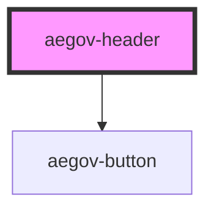

# aegov-header

A full-width government website header component for UAE Federal Government entities. Displays an official government identification bar, entity branding, and optional search functionality.

## Overview

The `aegov-header` component provides a standardised header for UAE government websites. It consists of two main sections:

1. **Top bar** — A dark banner identifying the site as an official UAE Federal Government website, with a "Learn more" expandable panel showing the entity name, domain, and the UAE national emblem. Includes navigation links for Accessibility and Language.
2. **Head section** — The entity logo (linked to the entity domain) and an optional search input.

The component uses **Shadow DOM** (`shadow: true`) for full style encapsulation.

## Features

- **RTL support** — All text strings (top bar, expanded panel, close button) automatically switch between English and Arabic based on the `dir` attribute on the document or nearest ancestor.
- **Skip to content** — When `skip-content-container` is provided, a skip navigation link is portaled to the top of `document.body` (always first in DOM/tab order regardless of page structure). The link is visually hidden until focused, then appears as a full-width banner.
- **Expandable info panel** — The "Learn more" link toggles an animated panel with entity details and the UAE emblem. Focus is trapped inside the panel while open and restored to the trigger when closed.
- **Keyboard support** — `Escape` closes the expanded panel. `Tab`/`Shift+Tab` cycle within the panel (focus trap).
- **Variants** — `ministry` (default) and `authority` for different entity types.

## Usage

### Basic

```html
<aegov-header
  entity-name="Ministry of Energy and Infrastructure"
  entity-domain="www.moei.gov.ae"
>
  
</aegov-header>
```

### With skip to content

```html
<aegov-header
  entity-name="Ministry of Energy and Infrastructure"
  entity-domain="www.moei.gov.ae"
  skip-content-container="main-content"
>
  
  <aegov-input slot="search" type="search" placeholder="Search..." size="base">
    <svg slot="icon-start" xmlns="http://www.w3.org/2000/svg" width="20" height="20"
      viewBox="0 0 24 24" fill="none" stroke="currentColor" stroke-width="2"
      stroke-linecap="round" stroke-linejoin="round">
      <circle cx="11" cy="11" r="8"/><path d="m21 21-4.3-4.3"/>
    </svg>
  </aegov-input>
</aegov-header>

<main id="main-content">
  <!-- Page content -->
</main>
```

### RTL

```html
<html dir="rtl" lang="ar">
  <body>
    <aegov-header
      entity-name="وزارة الطاقة والبنية التحتية"
      entity-domain="www.moei.gov.ae"
      skip-content-container="main-content"
    >
      
    </aegov-header>
    <main id="main-content"></main>
  </body>
</html>
```

## Slots

| Slot       | Description                              |
| ---------- | ---------------------------------------- |
| `logo`     | Entity logo image or SVG                 |
| `search`   | Search input (displayed on `md+` screens)|

## Accessibility

- The "Learn more" toggle has `aria-expanded` and `aria-controls` attributes.
- The expanded panel traps focus and supports `Escape` to close.
- When `skip-content-container` is provided, a skip link is portaled to the very first position in `document.body`, ensuring it is always the first focusable element on the page regardless of other elements above the header.
- The skip link sets `tabindex="-1"` on the target container and moves focus to it on activation.

<!-- Auto Generated Below -->


## Properties

| Property               | Attribute                | Description                                                                                                                                                                           | Type                        | Default      |
| ---------------------- | ------------------------ | ------------------------------------------------------------------------------------------------------------------------------------------------------------------------------------- | --------------------------- | ------------ |
| `entityDomain`         | `entity-domain`          | The domain/URL of the government entity. Required.                                                                                                                                    | `string`                    | `undefined`  |
| `entityName`           | `entity-name`            | The name of the government entity. Required.                                                                                                                                          | `string`                    | `undefined`  |
| `skipContentContainer` | `skip-content-container` | The CSS selector or ID of the main content container to skip to (e.g. "#main-content"). When provided, renders a "Skip to content" link before the header for keyboard accessibility. | `string`                    | `undefined`  |
| `variant`              | `variant`                |                                                                                                                                                                                       | `"authority" \| "ministry"` | `'ministry'` |


## Dependencies

### Depends on

- [aegov-button](../aegov-button)

### Graph


----------------------------------------------

*Built with [StencilJS](https://stenciljs.com/)*
